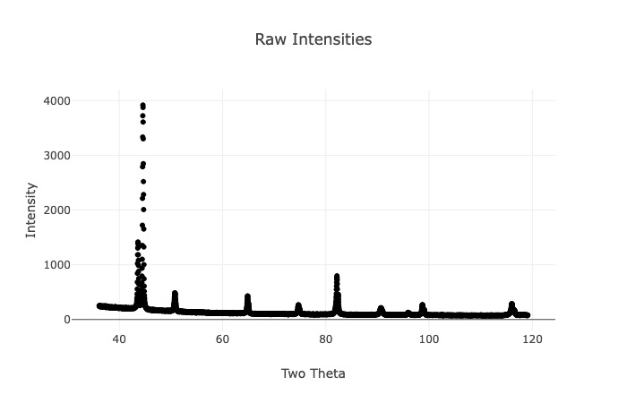
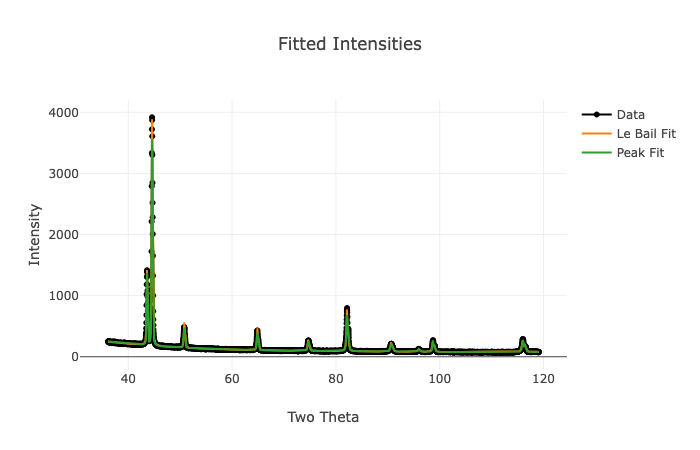
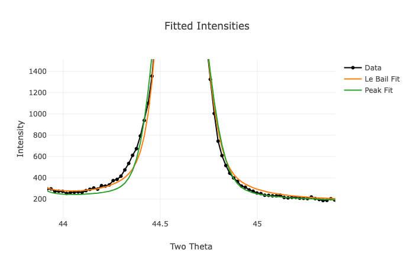
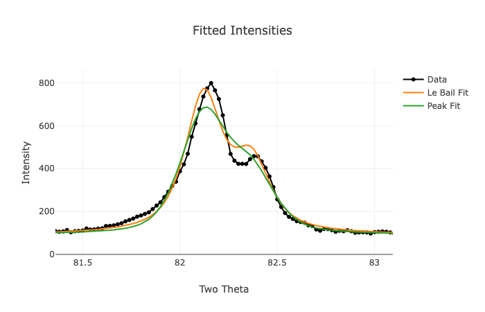
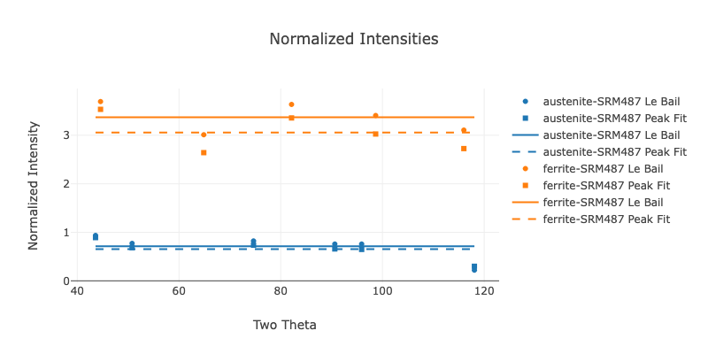
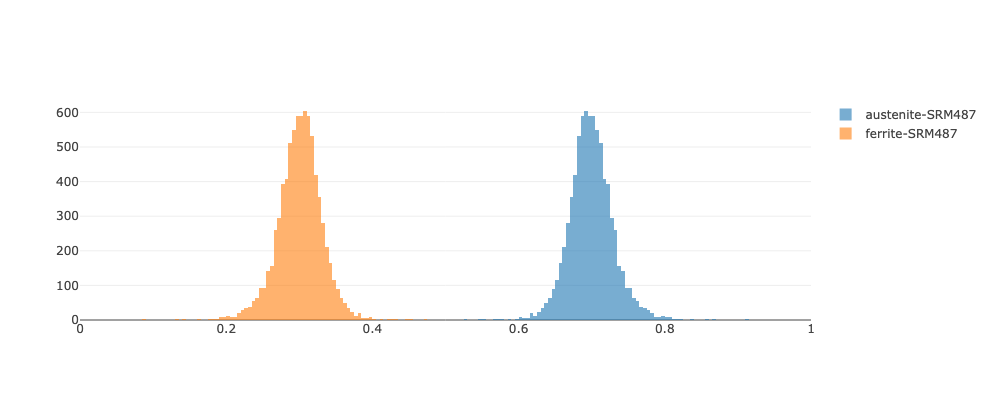

Example 02 - Multiple Samples of Duplex Steel With Texture Correction
=======================================================================

=========================
Background
=========================

As part of the research efforts in the NIST Center for Automotive Lightweighting (NCAL) [NCAL]_, steel with multiple phases are deformed via uniaxial (single direction) and multiaxial methods to assess the formability.

One of the materials investigated was a duplex steel, composed of near equal amounts of ferrite and austenite.  Upon loading the austenite will transform into a third phase, martensite, which provides additional strengthening mechanisms which may delay necking and fracture.

HAVE NOT EDITED BELOW

The National Institute of Standards and Technology (NIST, formerly the National Bureau of Standards or NBS) develops Standard Reference Materials (SRMs) and Reference Materials (RMs) for the support of accurate and compatible measurements.

The SRM 487 series [NBS-SRM-487]_ were developed to nominally have volume percents of 30% retained austenite mixed with 70% martensite, obtained by combining AISI 310 and AISI 430 stainless steel powders respectively.  These phase fractions were measured via optical microscopy after etching and inferred from x-ray fluorescence (XRF) measurements of the Ni content; but were not measured with x-ray diffraction.  Subsequent disagreement between the x-ray diffraction measurement and the certified values led to the SRM 487 series being withdrawn as an SRM.

While SRM 487 is no longer approved as an SRM, it remains a well documented and characterized sample, and was used an an example material.  As noted, the set of SRM 487 samples were created to have approximately 30% austenite.  The particular sample identifier "157" has a value inscribed of 32.46%, derived from the XRF value and uncertainty of 0.5% [NBS-SRM-487]_.  Note that the precise value is likely unreliable and the reason this SRM series was withdrawn.

=========================
File Creation
=========================

SRM 487 and a LaB6 660c SRM for instrument calibration were scanned on a Bruker D8 Discover. Energy rejection via a lower energy limit of 7200 eV was used to reduce florescence effects.  A 1 mm circular aperture and 4 mm raster in x and y was used.  The W_F and H_F were set to 1 mm to match the circular aperture.  As a 2D detector was used, the 1D pattern was summed from a 16 degree (+/- 8 deg) angular window, which corresponds to slightly more than 70 mm H_R. The system was well aligned, so an initial sample_displacement value was set to 0.  **Check details of optics and scan settings.** Instrument file creation used the same settings and used the tutorial [GSAS-II-FindProfParamCW]_.

The record for SRM 487 [NBS-SRM-487]_ provides the chemical compositions in weight percent, these were translated to atomic fractions for the .cif files.  Of the elements listed, only Fe, Cr, Si, Mn, C, Ni were used and the atomic fraction of these elements were summed to 1.  Preliminary fitting in GSAS-II was used to approximate the unit cell size and create the .cif files. **Source for Uiso?**  The martensite was approximated as body centered cubic (BCC) as there was a low fraction of carbon.  No significant tetragonality was noted in the fits or patterns, so the term 'ferrite' was substituted for 'martensite' in much of the following file names and discussion.

[NBS-SRM-487]_ also provided the mesh ranges for powder particle sizes for the austenite and martensite.  These were converted to approximate sizes of 50 micrometers and 40 micrometers respectively. The number of crystallites per powder particle was not measured, so a value of 10 crystallites per particle was used. Choosing 10 instead of a larger number results an upper limit on uncertainty (fewer crystallites illuminated).  As the powdering process likely induced rapid solidification, a rocking angle of 1 degree was used based on the Deformed crystals guidance in [Alexander-1948]_.

=========================
Results
=========================
.. list output with version number

---------------------------------------
'Intensity Plots'
---------------------------------------

Example 'Raw Intensities' and 'Fitted Intensities' data are shown below.  As noted, hovering over the plots will show a menu to select, pan or reset the axes, and to save a .png file of the current view.

The 'Peak Fit' data generally gives a closer fit to the data than the 'Le Bail' fit. As shown below, both fits struggle with the ferrite (110) leading edge (at lower two theta) and ferrite (211), but area is pretty consistent as shown below.

   

The 'Notes for User on Austenite Calculation' table is mainly composed of diagnostic messages.  The 17.7740 micrometer sample displacement is small, as expected.

---------------------------------------
'Normalized Intensities'
---------------------------------------
An example 'Normalized Intensities' plot is shown below.

There's a clear offset in the normalized intensities between Le Bail and individual peak fit methods, particularly for the ferrite phase. The ferrite (200) peak is noticeably below the other data points for the ferrite phase. Both phases have a downward slope as a function of two theta. At present there is no clear mechanism identified for these, but they are repeatable.

Below the plot, the 'Fit Values per Peak Summary Table' displays the fits for two theta position, intensity, Gaussian (sig) width, and Lortenzian (gam) width in addition to the normalized intensity data.  The 'Calculated Theoretical Intensities per Peak' table includes theoretical intensities calculated from the .cif files for reference if the users would like to compare to other calculations.

---------------------------------------
'Phase Fraction'
---------------------------------------

To compare the phase fraction values to the SRM value, 'Volume Fraction' was selected from the 'Choose Units to Display Phase Fraction' pull down menu.  The table below shows typical values for the phase fraction by volume and figure shows a the phase fraction histogram.

.. note::
    Owing to random seeding and nature of the MCMC analysis, the values shown from run to run may not be numerically identical to the numerical precision shown in the table.  Inspection of repeated runs from this example showed variation on the order of 0.001 was typical and much smaller than the +/- 0.028 1sigma variation of the phase fraction.

+-------------------+-------------+------------+-------------+------------+----------------+--------------+
|  Phase            | Neg_2sigma  | Neg_1sigma |    Mean     | Pos_1sigma |    Pos_2sigma  |   Median     |
+===================+=============+============+=============+============+================+==============+
| ferrite-SRM487    | 0.640229    |  0.671942  |  0.699544   |  0.727234  |   0.764698     |  0.698351    |
+-------------------+-------------+------------+-------------+------------+----------------+--------------+
| austenite-SRM487  | 0.235302    |  0.272766  |  0.300456   |  0.328058  |   0.359771     |  0.301649    |
+-------------------+-------------+------------+-------------+------------+----------------+--------------+

The mean phase fraction value of 0.300 is close to the nominal 30% intended for SRM 487.  The +/- 0.028 1sigma bounds are symmetric to the positive and negative directions, but the 2sigma bounds show some skew toward negative values with -0.065 neg_2sigma and +0.059 pos_2sigma from the mean, which is also visible in the histogram.

The 'Sources of Uncertainty (scaled by normalized intensity)' table is shown below, broken into two separate tables due to size.

Part 1:

+-----------------------+-----------------+-----------------+
|   Phase               |  Mean_n_int_fit | Median_phase_mu |
+=======================+=================+=================+
| ferrite-SRM487        | 3.0579          |   3.0653        |
+-----------------------+-----------------+-----------------+
| austenite-SRM487      | 0.6523          |   0.6762        |
+-----------------------+-----------------+-----------------+

The Mean_n_int_fit and Median_phase_mu are nearly the same, which is a good check on MCMC values.

Part 2:

+-------------------+------------+-----------+---------+--------------+
|       Phase       | sigma_exp  | count_fit | int_fit | N_Diff_95pct |
+===================+============+===========+=========+==============+
| ferrite-SRM487    |   0.3821   |  0.0364   | 0.0292  | 0.0301       |
+-------------------+------------+-----------+---------+--------------+
| austenite-SRM487  |   0.1734   |  0.0156   | 0.0107  | 0.0161       |
+-------------------+------------+-----------+---------+--------------+

.. note::
    The prefixes 'Median' and 'n_u' was removed from Part 2 to fit on the page.  'Diffracting' was also shortened to 'Diff'.

From part 2, the Median_sigma_exp larger than any of the other sources of uncertainty. The value for ferrite is larger than austenite indicating that the uncertainty in the ferrite normalized intensity is the dominant source of uncertainty, but is of same order of magnitude as the austenite phase.

The Median_n_u_count_fit, Median_n_u_int_fit, Median_n_u_N_Diffracting_95pct all of comparable order of magnitude and approximately 10x lower than Median_sigma_exp. This indicates the number of x-ray counts, fit quality, and number of crystallites in the diffraction condition are less significant contributions to uncertainty than the variation in normalized intensity.

The 'Sources of Uncertainty (per peak, scaled by normalized intensity)' table shows some variation by peak, but the variation is largely within the same order of magnitude.  This supports the use of the median value for each column, separated by phase, as an input to the MCMC calculation.

---------------------------------------
Crystallites Illuminated
---------------------------------------

The 'Interaction Volume Table' shows the calculated number of layers, crystallites illuminated and number of crystallites in the diffraction condition.  There are more ferrite grains illuminated than austenite, owing to the smaller power particulate size and larger phase fraction.  As expected, the penetration depth increases as the two theta increases as the incident angle increases.  This is visualized in the 'Z Depth Histogram Plot' and 'Incident Angle Plot'

.. note::
    The 'n_u_N_Diffracting_95pct' in 'Sources of Uncertainty (per peak, scaled by normalized intensity)' are based on the individual n_int_fit, not the mean n_int_fit.  This explains why the 'n_u_N_Diffracting_95pct' value for the austenite (400) peak is less than for the (222) peak, despite fewer crystallites in the diffraction condition as shown in 'N_Diffracting_95pct'.
    
    
=========================
Summary
=========================

The results from the Austenite Calculator show a mean phase fraction value of 0.300 with +/- 0.028 1sigma bounds. As noted this is close to the nominal 0.30 intended for SRM 487.  The mean value is quite different from the .3246 +/- 0.005 stated on the sample and [NBS-SRM-487]_, but the uncertainties do overlap. The largest source of uncertainty as reported by the Austenite Calculator is the variation in normalized intensities from the ferrite phase, followed by the variation in normalized intensities from the austenite phase. The other sources of uncertainty considered, number of x-ray counts, reported fit uncertainty, and number of diffracting crystallites were approximately an order of magnitude smaller.

No judgement on which value is more 'accurate' was made based on this example.

