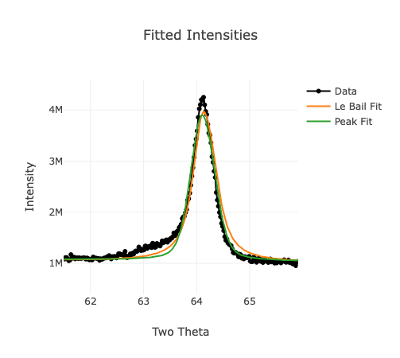
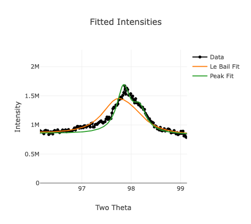
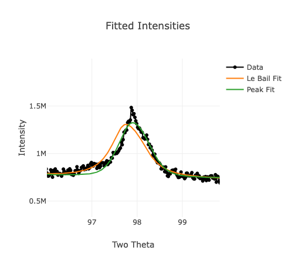
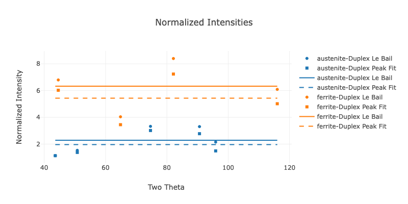
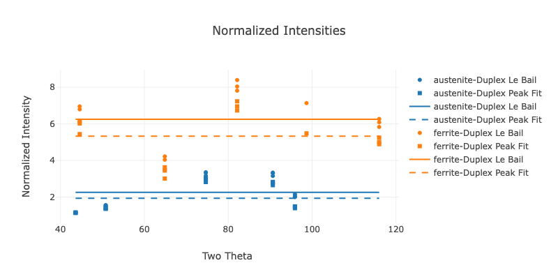
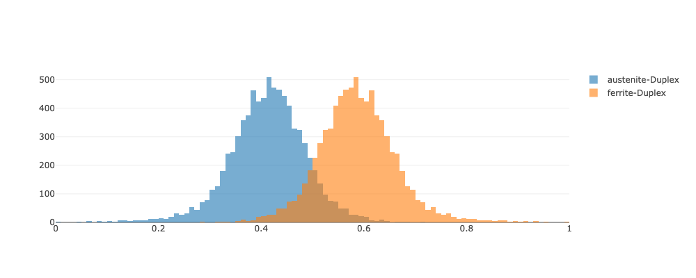

Example 02 - Multiple Samples of Duplex Steel With Texture Correction
=======================================================================

=========================
Background
=========================

As part of the research efforts in the NIST Center for Automotive Lightweighting (NCAL) [NCAL]_, steel with multiple phases are deformed via uniaxial (single direction) and multiaxial methods to assess the formability.

One of the materials investigated was a duplex steel, composed of near equal amounts of ferrite and austenite. The ferrite phase is :math:`\delta`-ferrite, which forms at higher temperatures than the austenite or :math:`\alpha`-ferrite. As such, the grains of the ferrite phase are much larger than typical, and much larger than the austenite phase. This material was studied previously in [Cox-2023]_, which shows some of the microstructure and measured texture values.  The phase fractions by volume were measured via neutron diffraction to be 0.53 +\- 0.055.  Additional XRD measurements along the ND without texture correction resulted in phase fractions closer to 0.4.

Data in this example was used in [Gregg-2025]_, where 35 non-overlapping locations were measured relative on a polished surface with diffraction vectors along the normal direction of the rolled sheet.  For this example, data from only 3 locations were chosen to limit the time required to run the example while showing the application when multiple measurements (samples) are taken of the same specimen.

=========================
File Creation
=========================

Duplex steel and a LaB6 660c SRM for instrument calibration were scanned on a Bruker D8 Discover. Energy rejection via a lower energy limit of 7200 eV was used to reduce florescence effects.  A 2 mm circular aperture and 3 mm raster in x and y was used.  The W_F and H_F were set to 2 mm to match the circular aperture.  As a 2D detector was used, the 1D pattern was summed from a 16 degree (+/- 8 deg) angular window, which corresponds to slightly more than 70 mm H_R. There was a significant offset in the sample position that was not discovered when the data was acquired, so the initial sample_displacement value was set to 900 (micrometers). Instrument file creation used the same settings and used the tutorial [GSAS-II-FindProfParamCW]_.

A chemical assay was performed to determine the chemical compositions in weight percent, these were translated to atomic fractions for the .cif files.  Of the elements listed, only Fe, Cr, Mn, Ni, Si, Cu, and C were used and the atomic fraction of these elements were summed to 1. The composition was assumed to be the same between the two phases. Preliminary fitting in GSAS-II was used to approximate the unit cell size and create the .cif files. **Source for Uiso?**

Grain size and texture correction values from [Cox-2025]_ were used to populate the Crystallites Illuminated JSON file.  The grain shapes were much more pancake than spherical shaped as the Austenite Calculator currently expects.  As the penetration depth is smaller than the grain thickness (normal direction), the approximate sizes along the rolling direction and transverse directions were used for crystallite size.  These were 10 micrometers for austenite and 100 micrometers for ferrite.   One crystallite per particle and rocking angle of 1 degree was used based on the deformed crystals guidance in [Alexander-1948]_.  Texture correction values from neutron diffraction were used, as the material has significant texture effects.  With

=========================
Results
=========================

On the 'Data Upload' tab under 'Option 2: Use Example Files', select 'Example 02 (Multiple Samples)' and press 'Submit'.

---------------------------------------
'Intensity Plots'
---------------------------------------

The pull down menu 'Which Dataset' is important for this example.  After the analysis completes, you can choose between 'Dataset_1', 'Dataset_2', 'Dataset_3', and 'Dataset_multi'.  The plots and 'Notes for User on Austenite Calculation' table will update depending on which dataset is selected.  The plots and tables appear and are numbered in the order uploaded.

The 'Raw Intensities' and 'Fitted Intensities' data are similar to that shown in :doc:`Example01`.  As in that example, hovering over the plots will show a menu to select, pan or reset the axes, and to save a .png file of the current view.

The 'Peak Fit' data generally gives a closer fit to the data than the 'Le Bail' fit. The ferrite data often has asymmetry on the leading edge (at lower two theta), as shown in detail below.

   
Selecting 'Dataset_multi' displays only the initial dataset in the plots, but appends data from each of the 'Notes for User on Austenite Calculation' to the table. In this table, the sample displacements are approximately 850 micrometers in each sample.

In addition, the ferrite (220) peak was removed in 2 of the 3 examples, as the fit uncertainty was 10 times larger than the median value.  Looking at the details of the fits from the first and second data sets (top image and bottom image respectively), the peak fit is substantially better in the second data set.

---------------------------------------
'Normalized Intensities'
---------------------------------------
Example 'Normalized Intensities' plots are shown below for 'Dataset_1' and 'Dataset_multi' (top image and bottom image respectively).  Note that 'Dataset_1' is missing the (220) ferrite data, as that was removed due to poor fit.  When 'Dataset_multi' is selected the plot shows markers for each of the datasets, and the tables concatenate all results.

For the normalized intensity data, even with the applied texture correction values shown in the 'Calculated Theoretical Intensities per Peak' table, the normalized intensities do not fall cleanly on a line. This indicates the texture has not been completely addressed.  However, the values used for texture correction were consistent even when investigating different sources for the data (neutron diffraction, x-ray diffraction, and electron backscatter diffraction (EBSD)) [Cox-2025]_.  The 'Dataset_multi' plot shows the effect between different measurements (samples) with some variation visible between samples.

In the 'Fit Values per Peak Summary Table', comparing the Gaussian (sig) width and Lortenzian (gam) values show some of the fitting challenges.  For the Le Bail (LB) fits, the sigma value is smaller than the individual peak fit (fit) values, almost by an order of magnitude; while the Lortenzian (gam) values are smaller for the individual peak fit (fit) than the Le Bail (LB) fits.  These two peak shape functions can be highly correlated, so this demonstrates one of the challenges in peak fitting. In addition, the normalized intensities show some variation between peak fitting methods (**not a currently implemented source of uncertainty**).  The (220) ferrite data in 'Dataset_1' sig_fit and gam_fit values are outliers compared to the rest of the values as well, which explains the poor fit and exclusion from the data.

---------------------------------------
'Phase Fraction'
---------------------------------------

To compare the phase fraction values to [Cox-2023]_, 'Volume Fraction' was selected from the 'Choose Units to Display Phase Fraction' pull down menu.  The table below shows typical values for 'Dataset_1' for the phase fraction by volume and the figure shows the phase fraction histogram.

.. note::
    Owing to random seeding and nature of the MCMC analysis, the values shown from run to run may not be numerically identical to the numerical precision shown in the table.

+-------------------+-------------+------------+-------------+------------+----------------+--------------+
|  Phase            | Neg_2sigma  | Neg_1sigma |    Mean     | Pos_1sigma |    Pos_2sigma  |   Median     |
+===================+=============+============+=============+============+================+==============+
| austenite-Duplex  | 0.244099    |  0.345363  |  0.412128   |  0.481531  |   0.560815     |  0.41544     |
+-------------------+-------------+------------+-------------+------------+----------------+--------------+
| ferrite-Duplex    | 0.439185    |  0.518469  |  0.587872   |  0.654637  |   0.755901     |  0.58456     |
+-------------------+-------------+------------+-------------+------------+----------------+--------------+

The mean austenite phase fraction value of 0.412 is not close to 0.55 from neutron diffraction, but is close to the 0.4 value from x-ray diffraction without texture correction [Cox-2023]_.  The 1sigma bounds are approximately +/- 0.07 and symmetric to the positive and negative directions, but the 2sigma bounds show some skew toward negative values with -0.17 neg_2sigma and +0.15 pos_2sigma from the mean.  However, there is much more uncertainty in this measurement and those shown in [Cox-2023]_ compared to :doc:`Example01`.

The 'Sources of Uncertainty (scaled by normalized intensity)' table is shown below, broken into two separate tables due to size.

Part 1:

+-----------------------+-----------------+-----------------+
|   Phase               |  Mean_n_int_fit | Median_phase_mu |
+=======================+=================+=================+
| austenite-Duplex      | 1.9624          |   1.9658        |
+-----------------------+-----------------+-----------------+
| ferrite-Duplex        | 5.4642          |   5.4247        |
+-----------------------+-----------------+-----------------+

The Mean_n_int_fit and Median_phase_mu are nearly the same, which is a good check on MCMC values.

Part 2:

+-------------------+------------+-----------+---------+--------------+
|       Phase       | sigma_exp  | count_fit | int_fit | N_Diff_95pct |
+===================+============+===========+=========+==============+
| austenite-Duplex  |   0.9658   |  0.0004   | 0.0299  | 0.0191       |
+-------------------+------------+-----------+---------+--------------+
| ferrite-Duplex    |   1.5098   |  0.0007   | 0.0893  | 0.3761       |
+-------------------+------------+-----------+---------+--------------+

.. note::
    The prefixes 'Median' and 'n_u' was removed from Part 2 to fit on the page.  'Diffracting' was also shortened to 'Diff'.

From part 2, the Median_sigma_exp larger than any of the other sources of uncertainty. The value for ferrite is larger than austenite indicating that the uncertainty in the ferrite normalized intensity is the dominant source of uncertainty, but is of same order of magnitude as the austenite phase.  The Median_n_u_N_Diffracting_95pct for the ferrite phase is smaller but a similar order of magnitude to the Median_sigma_exp values.  This indicates that the number of diffracting grains for the ferrite phase is small and a significant source of uncertainty.

The Median_n_u_int_fit and Median_n_u_N_Diffracting_95pct for austenite values are approximately 100x lower than Median_sigma_exp, so they are less significant contributions to uncertainty than the variation in normalized intensity and number of diffracting ferrite grains. The Median_n_u_count_fit is nearly 10 000x lower than Median_sigma_exp and would contribute negligibly to the uncertainty.  This implies the acquisition time could be reduced significantly.

The 'Sources of Uncertainty (per peak, scaled by normalized intensity)' table shows some variation by peak, but the variation is largely within the same order of magnitude.  This supports the use of the median value for each column, separated by phase, as an input to the MCMC calculation.

HAVE NOT EDITED BELOW

---------------------------------------
Crystallites Illuminated
---------------------------------------

The 'Interaction Volume Table' shows the calculated number of layers, crystallites illuminated and number of crystallites in the diffraction condition.  There are more ferrite grains illuminated than austenite, owing to the smaller power particulate size and larger phase fraction.  As expected, the penetration depth increases as the two theta increases as the incident angle increases.  This is visualized in the 'Z Depth Histogram Plot' and 'Incident Angle Plot'

.. note::
    The 'n_u_N_Diffracting_95pct' in 'Sources of Uncertainty (per peak, scaled by normalized intensity)' are based on the individual n_int_fit, not the mean n_int_fit.  This explains why the 'n_u_N_Diffracting_95pct' value for the austenite (400) peak is less than for the (222) peak, despite fewer crystallites in the diffraction condition as shown in 'N_Diffracting_95pct'.
    
    
=========================
Summary
=========================

The results from the Austenite Calculator show a mean phase fraction value of 0.300 with +/- 0.028 1sigma bounds. As noted this is close to the nominal 0.30 intended for SRM 487.  The mean value is quite different from the .3246 +/- 0.005 stated on the sample and [NBS-SRM-487]_, but the uncertainties do overlap. The largest source of uncertainty as reported by the Austenite Calculator is the variation in normalized intensities from the ferrite phase, followed by the variation in normalized intensities from the austenite phase. The other sources of uncertainty considered, number of x-ray counts, reported fit uncertainty, and number of diffracting crystallites were approximately an order of magnitude smaller.

No judgement on which value is more 'accurate' was made based on this example.

------

Peak asymmetry due to large aperature?  Large grains? Transformation?

